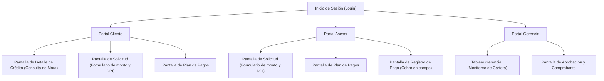

# Entregable E2: Arquitectura de Información y Wireframes

## 1. Mapa de Navegación y Tabla de Correspondencia

El sistema "Crédito Vecino" se divide en tres portales principales según el perfil de usuario. A continuación, se presenta la tabla de correspondencia entre los casos de uso (Puertos) y las pantallas del sistema:

| Caso de Uso / Puerto (Core) | Pantalla Correspondiente (Frontend) | Actor Principal |
| :--- | :--- | :--- |
| **Originación de Crédito** | Pantalla de Solicitud (Formulario de monto y DPI) | Asesor en campo / Cliente |
| **Simulación de Crédito** | Pantalla de Plan de Pagos (Tabla de cuotas con cuadre) | Asesor en campo / Cliente |
| **Desembolso** | Pantalla de Aprobación y Comprobante de Transferencia | Gerencia |
| **Cobro de Cuota** | Pantalla de Registro de Pago (Botón con Idempotencia) | Asesor en campo |
| **Consulta de Mora** | Pantalla de Detalle de Crédito (Alerta de Cambio de Tramo) | Cliente |
| **Monitoreo de Cartera** | Tablero Gerencial (Dashboard de KPIs) | Gerencia / Comité |

### Diagrama de Navegación del Sistema (Mermaid)

---

## 2. Wireframes de Baja Fidelidad

*(Nota para el equipo: Aquí deben pegar las fotografías de los dibujos a mano o prototipos en blanco y negro hechos en Balsamiq/Excalidraw que hicimos ANTES de pasar a Figma. Esta es la evidencia del proceso iterativo).*

**Pantallas clave a incluir en boceto:**
1. Formulario de Solicitud (con separador de miles).
2. Plan de Pagos (mostrando el cuadre del centavo en la cuota 12).
3. Pantalla de Cobro (con el botón grande para el asesor).
4. Portal del Cliente (mostrando el aviso preventivo de mora).
5. Tablero Gerencial.

---

## 3. Justificación de la Jerarquía de Información en el Tablero Gerencial

Para el diseño del Tablero Gerencial, la arquitectura de información se estructuró basándose estrictamente en las necesidades del Comité de Crédito (Sección 7.8), priorizando la toma de decisiones rápidas sobre la revisión de casos individuales.

### ¿Qué se ve primero y por qué?
Al ingresar al tablero, el usuario ve inmediatamente en la parte superior central los **KPIs macroeconómicos** de la agencia, específicamente el **Porcentaje de Cartera en Riesgo (7.00%)**. 

**Justificación:** La Gerente de Riesgos no necesita ver primero la lista de clientes atrasados, sino el estado de salud global de la agencia. Si la cartera en riesgo supera un umbral de tolerancia, el comité debe tomar decisiones inmediatas (como frenar desembolsos). Poner este dato en la jerarquía visual más alta (mayor tamaño tipográfico y ubicación superior izquierda/central) reduce el esfuerzo cognitivo y el tiempo de reacción. Debajo de este indicador macro, se presenta el desglose secundario (Tramo 1, Tramo 2, etc.) para profundizar en el análisis si es necesario.

### Distinción visual entre Cartera en Mora y Cartera en Riesgo
Para evitar el "Momento Crítico" de confusión financiera, ambas métricas se separaron espacial y cromáticamente:

* **Cartera en Mora (21.75%):** Representa el volumen total de atrasos (desde 1 día). Se diseñó en una tarjeta secundaria con un color de advertencia leve (Amarillo/Naranja) o un tono neutro, ya que es un comportamiento operativo normal en microfinanzas.
* **Cartera en Riesgo (7.00%):** Representa el peligro inminente de incobrabilidad (>30 días). Se posicionó como la métrica principal, utilizando un color de alerta severa (Rojo/Crimson) y tipografía de mayor peso (Bold). 

Adicionalmente, se incluyó un gráfico de dona (o barras) que desglosa visualmente qué porcentaje de la cartera total pertenece a cada clasificación, evitando que la gerencia mezcle los conceptos o paralice las operaciones de forma equivocada.
